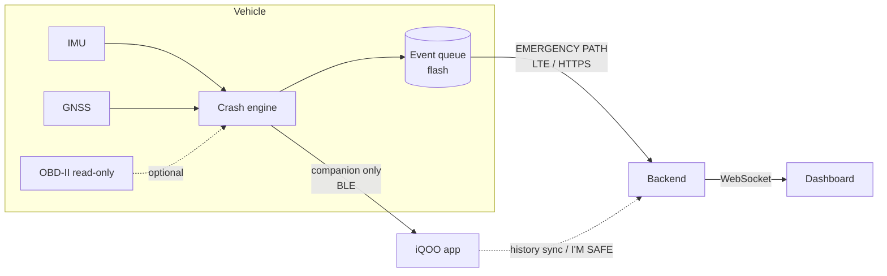
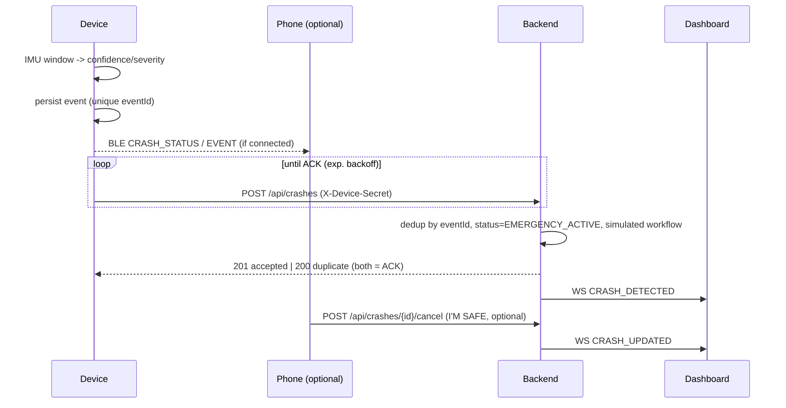

# Architecture

## Components

| Component | Tech | Role |
|---|---|---|
| Guardian Device | ESP32, IMU, GNSS, LTE, battery, OBD-II (read-only) | Detects crashes, stores events, reports over **its own** cellular link |
| Guardian App | Android, Kotlin, Compose | Companion: status, alerts, I'M SAFE, history, demo controls |
| Guardian Backend | FastAPI, SQLAlchemy, SQLite/PostgreSQL | Receives device events, dedups, runs simulated response workflow, broadcasts |
| Emergency Dashboard | React, MUI, React Query, Leaflet | Live incident view for the response center |
| Vehicle Simulator | Python stdlib | Software twin of the device for development and demo |

## Two independent paths



- **Emergency path:** `Device -> Cellular -> Backend -> Dashboard`. Never depends on the phone.
- **Companion path:** `Device <-> BLE <-> Phone`. Losing it changes nothing on the emergency path;
  events are flagged `phoneConnected=false`.

## Crash event lifecycle



## Device firmware structure

```text
core 1 loop():  IMU 100 Hz -> CrashDetector -> EventQueue      (never blocks on I/O)
core 0 task:    EventQueue -> CellularProvider -> backend; heartbeat; time sync
```

Every hardware interface (`ImuSensor`, `GnssProvider`, `CellularProvider`, `BleProvider`,
`VehicleTelemetryProvider`, `BatteryProvider`, `QueueStorage`) has a mock. The crash engine,
queue and scenario player are pure C++ and identical in behaviour to the Python simulator.

## Backend layers

`api/` (routers) → `services/` (device, crash state transitions + dedup, emergency workflow)
→ `repositories/` → `models/` (SQLAlchemy). `realtime/` fans events out to WebSocket clients.

## Android layers

`ui` → `GuardianViewModel` → `GuardianRepository` → (`SwitchableDeviceClient` [Mock | BLE],
`GuardianApi` [Retrofit], Room).

## Key design decisions

| Decision | Why |
|---|---|
| Device owns the emergency path | The phone is the most likely casualty of a crash |
| Persist before transmit; dedup on backend by `eventId` | Exactly-once delivery across outages and lost ACKs |
| Deterministic, configurable crash engine first | Explainable, testable; ML later (spec §35) |
| Robust k-th-largest peak | Rejects single-sample spikes (potholes, knocks) |
| Python reference engine mirrors C++ | Same behaviour testable without hardware |
| Simulated emergency workflow | No real dispatch without authorization (spec §36) |
| Phone-primary capture, device black-box fallback | Phone has richer sensors + on-device AI; the device guarantees delivery and keeps the evidence if the phone dies ([blackbox.md](blackbox.md)) |
