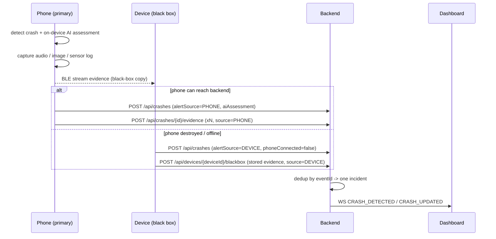

# Phone-Primary Capture + Device Black-Box Fallback

> Extends the core rule. The device still **owns the guaranteed emergency path**; this feature
> lets the phone act as the *primary* capture + alert source when it survives, while the vehicle
> device is the **black box** that preserves evidence and delivers the alert when the phone is gone.

## Why

The phone has the richest sensors (camera, microphone, high-rate IMU) and can run **on-device AI**
to understand a crash. But the phone is also the most likely casualty. Guardian therefore:

1. lets the phone capture evidence and send the alert **when it can**, and
2. keeps a **black-box copy on the vehicle device** so the alert and evidence survive even if the
   phone is destroyed, off, or offline.

Exactly one incident is ever created — backend dedup by `eventId` guarantees it.

## Roles

| Actor | Role |
|---|---|
| Phone (companion) | **Primary** when present: on-device AI assessment, captures audio/images/sensor logs, streams a copy to the device over BLE, sends the alert |
| Vehicle device | **Black box + fallback**: stores the streamed evidence, and if the phone does not deliver the alert, sends it over its own cellular link and uploads the stored evidence |
| Backend | Dedups by `eventId`, records who delivered the alert (`alertSource`), stores evidence, broadcasts to the dashboard |

## Flow



Because the phone and device share one `eventId`, whichever reaches the backend first becomes the
alert source; a later duplicate is a no-op.

## Data model additions

- `CrashEvent.alertSource` — `PHONE` or `DEVICE` (who delivered the alert).
- `CrashEvent.aiAssessment` — short natural-language summary from the phone's on-device AI.
- `BlackBoxEvidence` — one row per captured record, linked to the crash:

  | Field | Notes |
  |---|---|
  | `kind` | `AUDIO`, `IMAGE`, `SENSOR_LOG`, `TRANSCRIPT`, `AI_ASSESSMENT` |
  | `source` | `PHONE` or `DEVICE` (which actor captured/stored it) |
  | `label` | short human title |
  | `contentText` | inline text (transcript, sensor-log excerpt) — POC stores small text inline |
  | `mediaUrl` / `mediaMime` | reference to media bytes (data URI in the simulator demo) |
  | `capturedAt`, `storedBy`, `createdAt` | timing + black-box device id that holds the copy |

## Endpoints

| Method | Path | Auth | Purpose |
|---|---|---|---|
| `POST` | `/api/crashes/{eventId}/evidence` | none (phone/companion) | Attach one black-box record |
| `GET` | `/api/crashes/{eventId}/evidence` | none | List black-box records |
| `POST` | `/api/devices/{deviceId}/blackbox` | `X-Device-Secret` | Device batch-dumps stored evidence after a crash |

`POST /api/crashes` additionally accepts `alertSource` (default `DEVICE`) and `aiAssessment`.
`GET /api/crashes/{eventId}` and the WebSocket crash payloads include `alertSource`,
`aiAssessment`, and `evidence[]`.

## On-device AI

The phone runs a small on-device LLM (e.g. Gemma / LLaMA class) to produce the `aiAssessment`
from the crash signals and in-cabin audio: severity, likely mechanism (frontal / rollover),
occupant state from audio, and a recommended response. It runs **offline** and is never on the
critical delivery path — if AI is unavailable the alert still goes out with raw crash data.

## Try it (simulator)

```bash
cd simulator/vehicle-simulator
python simulator.py seed
python simulator.py phone_crash        # phone primary: AI + black box, PHONE delivers the alert
python simulator.py phone_dead_crash   # phone destroyed: DEVICE black box delivers alert + evidence
```

Both appear on the dashboard with the black-box panel (AI assessment, audio transcript, cabin
photo, impact sensor log) and an "Alert sent by phone / device black box" chip.

## Status

- [x] Backend: model, endpoints, dedup-based failover (38 backend tests pass)
- [x] Simulator: `phone_crash` / `phone_dead_crash`, on-device-AI mock, evidence capture, BLE transfer
- [x] Dashboard: black-box panel, AI assessment, alert-source chip
- [ ] Android: real on-device AI, BLE evidence transfer, phone-primary alert with device fallback
- [ ] ESP32: receive/store black box over BLE, send fallback alert
