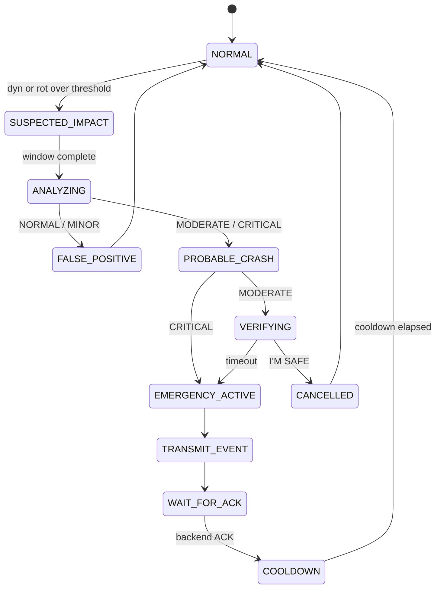

# Crash Detection (deterministic POC engine)

> Hackathon prototype. **Not** an automotive-certified crash detection algorithm.

Implementations (must stay identical):
- Firmware: `device/guardian-device/src/crash/crash_detector.{h,cpp}`, config `include/config/crash_config.h`
- Reference / simulator: `simulator/vehicle-simulator/crash_engine.py` (`CrashConfig`)

## Inputs

| Signal | Unit | Source |
|---|---|---|
| ax, ay, az | m/s² | IMU, 100 Hz, body frame (+x forward, +z up) |
| gx, gy, gz | rad/s | IMU |
| vehicle speed | km/h, optional | OBD-II PID 0x0D (or none) |

## Pipeline

```text
IMU sample
  -> gravity estimate (EMA, only while NORMAL)            gravity_alpha
  -> dynamic accel  dyn = |a - g_est| / 9.81  [g]
  -> rotation       rot = |gyro|              [rad/s]
  -> trigger if dyn >= impact_threshold_g or rot >= rotation_threshold_rad_s
  -> capture analysis window (analysis_window_ms)
  -> features:
       robust impact   = k-th largest dyn  (k = min_impact_samples)   <- rejects single spikes
       robust rotation = k-th largest rot
       impact count    = bursts >= threshold separated by repeated_impact_gap_ms
       speed drop      = speed(before trigger) - speed(end of window), if available
  -> confidence (weighted, normalised over available signals)
  -> severity
```

## Scoring

```text
impactScore   = clamp(robustImpactG     / severe_impact_g)
rotationScore = clamp(robustRotation    / severe_rotation_rad_s)
speedScore    = clamp(speedDrop         / severe_speed_drop_kmh)     (only if speed available)
repeatScore   = clamp((impactCount - 1) / 2)

confidence = Σ wᵢ·scoreᵢ / Σ wᵢ      over available signals
```

If neither robust impact nor robust rotation reaches its threshold → confidence 0
(`single_sample_spike`).

| Severity | Confidence | Device behaviour |
|---|---|---|
| NORMAL | < 0.25 | FALSE_POSITIVE → NORMAL |
| MINOR | ≥ 0.25 | logged locally, no emergency |
| MODERATE | ≥ 0.50 | VERIFYING (10 s, I'M SAFE cancels) → emergency |
| CRITICAL | ≥ 0.85 | emergency immediately (`critical_skips_verification`) |

## Configuration (defaults)

| Key | Default | Key | Default |
|---|---|---|---|
| gravity_alpha | 0.01 | analysis_window_ms | 1000 |
| impact_threshold_g | 2.5 | verification_window_ms | 10000 |
| severe_impact_g | 8.0 | critical_skips_verification | true |
| rotation_threshold_rad_s | 3.0 | post_event_cooldown_ms | 30000 |
| severe_rotation_rad_s | 6.0 | weight_impact | 0.45 |
| speed_drop_threshold_kmh | 10 | weight_rotation | 0.20 |
| severe_speed_drop_kmh | 60 | weight_speed | 0.25 |
| min_impact_samples | 3 | weight_repeated | 0.10 |
| repeated_impact_gap_ms | 150 | minor / moderate / critical | 0.25 / 0.50 / 0.85 |

Simulator override: `simulator/vehicle-simulator/crash_config.json`.

## State machine



**Duplicate prevention:** secondary impacts within the analysis window are merged
(`impactCount`); after an emergency, triggers are ignored until `post_event_cooldown_ms`.
Transmission retries are independent of the state machine (event queue).

## Reference results (synthetic scenarios)

| Scenario | Result (with speed) | Without speed |
|---|---|---|
| normal (10 s, lane change) | no trigger | no trigger |
| hard_brake (0.9 g to stop) | no trigger | no trigger |
| pothole (1-sample 3.5 g spike) | NORMAL 0.00, single_sample_spike | same |
| minor_impact (5 g, 80 ms, 20→8 km/h) | MINOR 0.31 | MINOR 0.34 |
| rollover (7 rad/s, 3× 3.5 g) | MODERATE 0.63 → verification | MODERATE 0.66 |
| severe_crash (10 g + spin + side hit, 72→0) | CRITICAL 0.92 | CRITICAL 0.89 |

## Tuning on hardware

1. Mount the IMU rigidly (+x to vehicle front). Log `status` and serial crash output.
2. Drive normal routes, speed bumps and hard stops: there must be no `PROBABLE_CRASH`.
3. Bench drop/strike tests (controlled, no vehicle crash) to check the trigger path.
4. Adjust only `crash_config.h` (and mirror into `CrashConfig`); re-run both test suites.

## Roadmap

Phase 2: ML severity classifier on the same features. Phase 3: contextual reasoning (location,
road type, occupant response). Cloud AI is never mandatory for detection.
